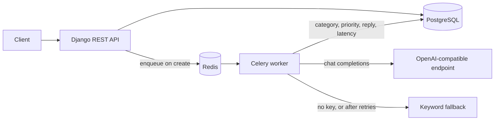

# ticketdesk-api

A helpdesk REST API for a fresher backend / AI portfolio. Customers open tickets, agents work them through a fixed status workflow, and a Celery worker classifies each new ticket — category, priority, and a suggested first reply — with an OpenAI-compatible model or a deterministic keyword fallback when no API key is set.

Live reference: [naveecode.github.io/ticketdesk-api](https://naveecode.github.io/ticketdesk-api/) (published when this branch is merged; the Pages workflow deploys from `main`).

[](https://github.com/naveecode/ticketdesk-api/actions/workflows/ci.yml)
[](https://naveecode.github.io/ticketdesk-api/)

## Architecture



`POST /api/tickets/` writes the row and returns immediately with `triage_status: pending`. The worker fills category, priority, suggested reply, source, model, and latency. Ticket creation still succeeds if Redis is down; the row stays pending and the failure is logged.

## Quickstart

Docker Compose runs the API, the worker, Redis, and PostgreSQL. No `.env` file is required. Leave `LLM_API_KEY` empty to use keyword triage.

```bash
docker compose up --build
docker compose exec api python manage.py seed_demo
```

The API listens on <http://localhost:8000>. Interactive docs: <http://localhost:8000/api/docs/> (Swagger) and <http://localhost:8000/api/redoc/>.

Seed accounts all use the password `Ticketdesk-demo-1`:

| Username | Role |
| --- | --- |
| admin | admin (also a Django superuser, so `/admin/` works) |
| sam, riley | agent |
| alice, bob, carol | customer |

```bash
curl -s http://localhost:8000/api/health/

curl -s -X POST http://localhost:8000/api/auth/token/ \
  -H 'Content-Type: application/json' \
  -d '{"username":"alice","password":"Ticketdesk-demo-1"}'

# then, with the access token:
curl -s 'http://localhost:8000/api/tickets/?status=open&search=refund' \
  -H "Authorization: Bearer $ACCESS"

curl -s -X POST http://localhost:8000/api/tickets/ \
  -H "Authorization: Bearer $ACCESS" \
  -H 'Content-Type: application/json' \
  -d '{"title":"Cannot download the March invoice","description":"The invoice link returns a 404 after I sign in.","tags":["billing"]}'
```

To call a model, put a key in the shell or a gitignored `.env` before `docker compose up`. `.env.example` lists every variable. Any chat-completions URL works (`LLM_BASE_URL`, `LLM_API_KEY`, `LLM_MODEL`).

Without Docker, SQLite is the default when `DATABASE_URL` is unset:

```bash
python3.12 -m venv .venv && source .venv/bin/activate
pip install -r requirements-dev.txt
python manage.py migrate
python manage.py seed_demo
python manage.py runserver
```

That process has no worker. New tickets stay `pending` unless you run `celery -A config worker --loglevel=info` against Redis, or you are looking at seeded rows (the seed command classifies them inline).

## API

All ticket routes require `Authorization: Bearer <access>`. Register and token routes are public. Access tokens last 30 minutes and carry `role` and `username`.

| Method | Path | Who | Purpose |
| --- | --- | --- | --- |
| POST | `/api/auth/register/` | public | Create a customer. `role` in the body is ignored. |
| POST | `/api/auth/token/` | public | JWT access and refresh tokens. |
| POST | `/api/auth/token/refresh/` | public | New access token. |
| GET | `/api/auth/me/` | any signed-in user | Caller id, username, email, role. |
| GET, POST | `/api/tickets/` | signed in | List visible tickets, or open one. |
| GET, PATCH, DELETE | `/api/tickets/{id}/` | signed in | Read, update, or delete. Delete is admin-only. |
| GET, POST | `/api/tickets/{id}/comments/` | signed in | List or add comments. |
| GET | `/api/tags/` | signed in | List tags. |
| POST | `/api/tags/` | agent, admin | Create a tag. Names are stored lowercase. |
| DELETE | `/api/tags/{id}/` | admin | Delete a tag. |
| GET | `/api/health/` | public | Database and Redis checks. |
| GET | `/api/schema/` | public | OpenAPI schema. |
| GET | `/api/docs/`, `/api/redoc/` | public | Swagger UI and ReDoc. |

List filters: `status`, `priority`, `category`, `assignee`, `requester`, `tags`. `search` matches title and description. `ordering` is `created_at` or `updated_at` (prefix `-` for descending). Pages are 10 rows by default; `page_size` caps at 50.

Customers only receive their own tickets. Another customer's id is a 404, including on retrieve, so the API does not confirm that the id exists. Agents and admins see the whole queue.

A customer create returns the defaults and `triage_status: pending`. Measured against a local SQLite process (no worker):

```json
{
  "id": 9,
  "title": "Cannot download the March invoice",
  "description": "The invoice link returns a 404 after I sign in.",
  "tags": ["billing"],
  "status": "open",
  "priority": "medium",
  "category": "general",
  "triage_status": "pending",
  "created_at": "2026-10-18T14:15:14.063147Z"
}
```

Seeded ticket 1, read back as agent `sam` after `seed_demo` on that same process. `triage_latency_ms` is 0 because the keyword classifier finished in under a millisecond; that integer is the measured value, not a placeholder:

```json
{
  "id": 1,
  "title": "Invoice charged twice this month",
  "status": "resolved",
  "priority": "high",
  "category": "billing",
  "requester": {"id": 4, "username": "alice", "role": "customer"},
  "assignee": {"id": 2, "username": "sam", "role": "agent"},
  "tags": ["billing"],
  "triage_status": "completed",
  "description": "The latest invoice includes a duplicate charge for the same seats.",
  "suggested_reply": "Thanks for contacting us about billing. An agent will review the charge and follow up with the next step.",
  "triage_source": "fallback",
  "triage_model": "",
  "triage_latency_ms": 0,
  "triage_error": ""
}
```

The same ticket read as `alice` has `suggested_reply`, `triage_source`, `triage_model`, `triage_latency_ms`, `triage_error`, and `triaged_at` set to `null`. Those fields are an agent aid. Comments with `is_internal: true` are omitted for customers.

Skipping a status returns 400. Measured after moving a ticket to `in_progress` and then sending `closed`:

```json
{"status": ["Cannot transition from in_progress to closed."]}
```

### Status workflow

| From | Allowed next status |
| --- | --- |
| open | in_progress |
| in_progress | resolved |
| resolved | closed, or back to in_progress |
| closed | open |

Sending the current status is a no-op. Only agents and admins can change status, priority, category, assignee, or tags. An assignee must be an agent or an admin. Customers can edit title and description only while the ticket is `open`.

### Triage

The worker calls `POST {LLM_BASE_URL}/chat/completions` with `temperature: 0` and asks for JSON (`category`, `priority`, `suggested_reply`). Timeouts, connection errors, HTTP 429, and HTTP 5xx retry with backoff of 1s, 2s, then 4s (`max_retries` 3). After the last failure, or immediately when `LLM_API_KEY` is empty, keyword rules assign the same three fields and `triage_source` is `fallback`. A 4xx other than 429, or a reply that is not the expected JSON, does not retry. The save uses `update_fields`, so a slow model call does not overwrite a status or assignee change made while it was in flight.

Keyword order is billing, then access, then technical, then account, otherwise general. Priority is `urgent` when the text contains urgent, asap, outage, down, or data loss; otherwise high for billing, access, and technical, medium for account, and low for general.

### Health and throttles

`/api/health/` returns 200 when the database answers `SELECT 1`, and 503 when it does not. `redis` is a separate boolean and does not by itself fail the check. A SQLite run on this machine with no Redis returned:

```json
{"status": "ok", "database": true, "redis": false}
```

Configured limits, not a load test: anonymous 60/minute, signed-in 300/minute, and login/register 20/minute.

## Design decisions

- JWT instead of session auth, so the API stays stateless. The Django admin at `/admin/` still uses sessions.
- Object visibility is the queryset, with an object permission as a second check. Hiding other customers' tickets as 404 avoids leaking ids.
- Customers do not set priority or category. Triage writes the first values; agents override them afterwards.
- The suggested reply is stored for agents and returned as `null` to customers, so the response shape does not change by role.
- Keyword triage is the offline path, not a second product. It keeps tests, the seed command, and a laptop without a key fully working.
- Tests run on SQLite in memory. Compose uses PostgreSQL 16. `psycopg` is the driver.
- Ticket creation catches a broker failure and logs it. A down Redis should not turn into a 500 on `POST /api/tickets/`.
- `DJANGO_SECRET_KEY` must be set when `DJANGO_DEBUG` is false. The Compose default is a local development key, not a production secret.

## Tests

From this workspace, Python 3.12, `pytest --cov --cov-report=term-missing` (branch coverage enabled in `pyproject.toml`):

**66 passed. 99% coverage** — 717 statements, 3 missed, 88 branches, 4 partial.

The missed statements are import-time branches in `config/settings.py` (unset boolean env vars, the production secret guard, and the PostgreSQL URL branch). CI runs the same pytest command, plus `ruff check`, `ruff format --check`, `manage.py check`, and `docker build`.

```bash
pytest --cov --cov-report=term-missing
ruff check .
ruff format --check .
```

## Layout

```
config/        settings, celery app, health, urls
accounts/      user model, registration, JWT
tickets/       tickets, comments, tags, workflow, triage, seed_demo
docs/          GitHub Pages walkthrough and ReDoc shell
.github/       CI and Pages workflows
```

## License

MIT. See [LICENSE](LICENSE).
